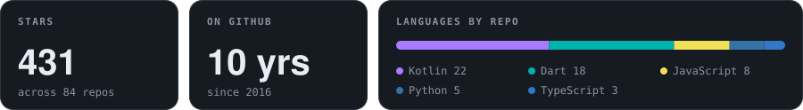
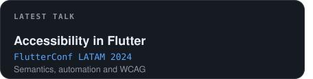
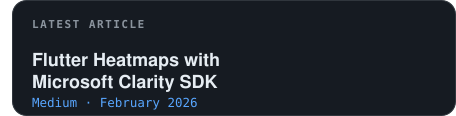

<a href="https://enzoftware.dev"><picture><source media="(prefers-color-scheme: dark)" srcset="assets/terminal-dark.svg"><source media="(prefers-color-scheme: light)" srcset="assets/terminal-light.svg"></picture></a>

  <a href="https://enzoftware.dev">Website</a> · <a href="https://linkedin.com/in/enzolizama">LinkedIn</a> · <a href="https://medium.com/@enzoftware">Writing</a> · <a href="https://x.com/enzoftware">X</a> · <a href="https://dev.to/enzoftware">dev.to</a>

<picture><source media="(prefers-color-scheme: dark)" srcset="assets/stats-row-dark.svg"><source media="(prefers-color-scheme: light)" srcset="assets/stats-row-light.svg"></picture>

### Stack

<a href="https://github.com/enzoftware/flutterconflatam_accesibility"><picture><source media="(prefers-color-scheme: dark)" srcset="assets/tile-talk-dark.svg"><source media="(prefers-color-scheme: light)" srcset="assets/tile-talk-light.svg"></picture></a><a href="https://medium.com/@enzoftware/flutter-heatmaps-with-microsoft-clarity-sdk-0fe651e14898"><picture><source media="(prefers-color-scheme: dark)" srcset="assets/tile-article-dark.svg"><source media="(prefers-color-scheme: light)" srcset="assets/tile-article-light.svg"></picture></a>

